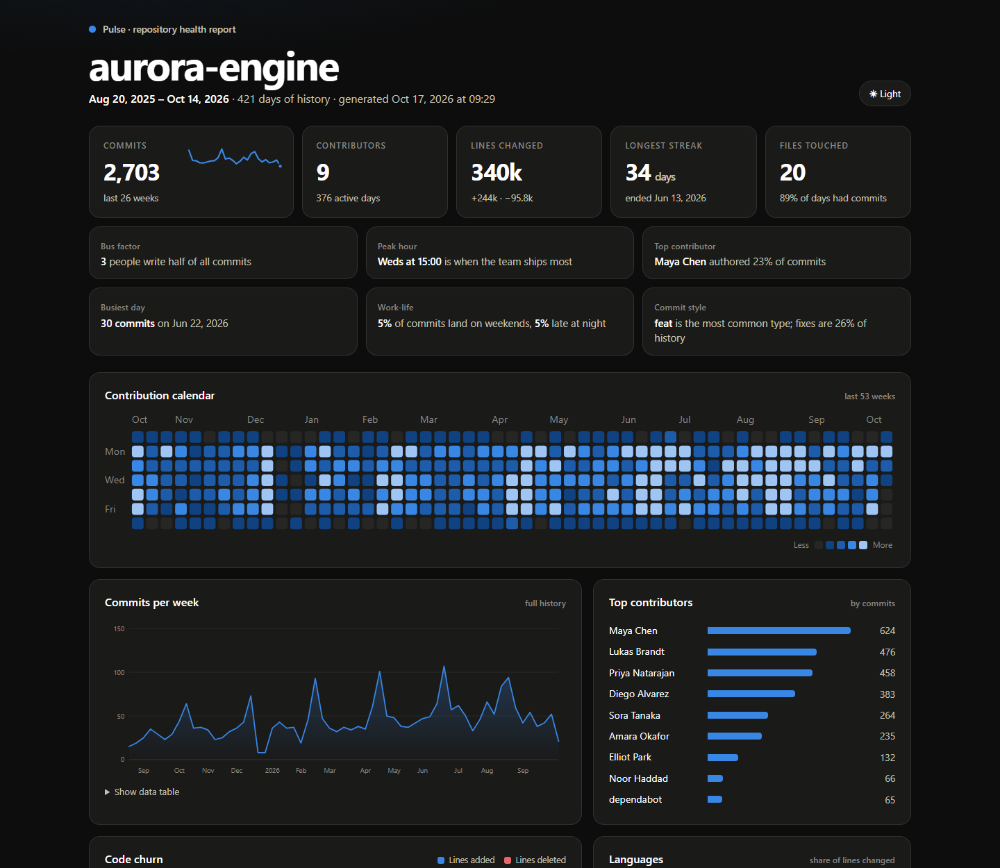

# 📈 Pulse: git analytics, beautifully

**Category: Data Visualization** | Python (standard library only) | hand-drawn SVG

Point Pulse at any git repository and in under a second it writes a polished, interactive dashboard: a contribution calendar, activity trends, code churn, a team punchcard, language mix, hotspots, and plain-English insights like your project's **bus factor**. The output is one self-contained HTML file, ready to email, attach to a PR, or host anywhere.



**[Open the live sample report →](https://devarqf.github.io/portfolio/pulse-demo.html)**

## Highlights

- **No dependencies.** No pandas, no matplotlib, no plotly. History is read straight from `git log --numstat`, and every bar, dot and line is generated as SVG by Python code in `charts.py`.
- **Interactive.** Every mark has a hover tooltip, and the weekly trend has a crosshair. The trend chart also includes a data-table view for accessibility.
- **Light and dark themes.** Each has its own tuned palette, follows your OS setting, and can be switched with a toggle.
- **Color-blind-safe palette.** The categorical colors were validated for color-vision deficiency (CVD) separation. Magnitude uses a single-hue sequential ramp, and additions/deletions use a diverging blue/red pair.
- **Generated insights.** Bus factor, peak hour, top contributor, busiest day, weekend and late-night work share, and commit style (conventional-commit aware).
- **Rename handling.** `src/{old => new}.py` paths are resolved, so a renamed file's history stays together.

## Run it

```bash
python pulse.py --demo --open              # showcase report from realistic synthetic history
python pulse.py path/to/any/repo --open    # your own project
python pulse.py . --since "6 months ago" -o health.html
```

| Flag | Meaning |
|---|---|
| `repo` | Path to a git repository (default `.`) |
| `--since` | Only include commits after a date (`2025-01-01`, `"3 months ago"`) |
| `--name` | Display name for the report header |
| `-o / --output` | Output file (default `pulse-<name>.html`) |
| `--demo` | Use a believable synthetic team history (growth, release crunches, holidays, time zones) |
| `--open` | Open the report in your browser |

## Architecture

```
collector.py   git log → Commit objects   (or demo(): synthetic history)
stats.py       Commit objects → Report    (streaks, calendar, punchcard, churn, hotspots…)
charts.py      Report fields → SVG/HTML   (calendar, area line, punchcard, diverging bars, sparkline…)
report.py      assembles a single HTML file with themed CSS and the tooltip layer
pulse.py       CLI
```
